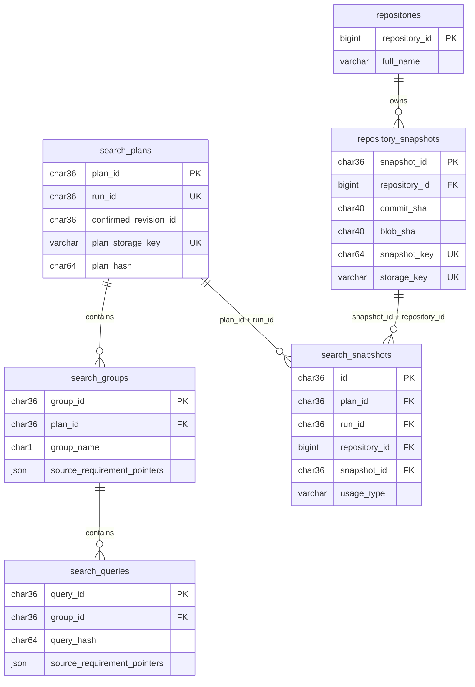

# ProjectPilot 六表 MySQL 最终设计稿（待确认）

## 1. 范围与审核结论

本文件仅为设计文档，不是已实施或已测试的数据库结构。仅保留六张应用业务表：search_plans、search_groups、search_queries、repositories、repository_snapshots、search_snapshots。不新增 search_executions、search_hits、通用任务表、需求版本表或操作日志表。未来 Alembic 自身的 alembic_version 属于迁移工具元数据，不属于应用业务表；它不会在本轮创建。

保持 MySQL 8.0.31、InnoDB、数据库默认 utf8mb4/utf8mb4_unicode_ci；不升级数据库，不修改用户输入与需求确认模块。本轮不创建 SQLAlchemy 模型、不生成迁移、不连接数据库。

当前代码尚无 SQLAlchemy 模型和 Alembic 迁移；以下 ORM 审核为拟定映射的静态设计审核，不能替代实际模型检查、DDL 编译或 MySQL 集成测试。

### 1.1 Requirement Schema 的实证差异

检查依据：backend/app/schemas/requirements.py。

- 第53—65行 RequirementJSON 实际为平铺字段：project_topic、required_features、programming_languages 等，没有 project_overview、functional_requirements、technical_requirements、extraction_metadata 四个容器。
- 第105—115行 RequirementRevision 包含 requirements 和 requirement_items；后者目前确实存在。本设计既不新增、删除，也不要求搜索来源引用它。
- 用户描述的四层结构与当前工作区不一致。不能声称示例 /functional_requirements/required_features/0 能在当前对象上解析成功，也不能通过迁移现有 Schema 消除差异。

最终确认以当前代码为权威：Pointer 根固定为 confirmed_revision_id 对应 RequirementRevision 的 requirements 对象。合法路径模板为 /project_topic、/project_description、/project_type、/domain，以及 /required_features/{index}、/preferred_features/{index}、/programming_languages/{index}、/required_technologies/{index}、/preferred_technologies/{index}。只有实际值为非空字符串且索引存在时才可作为来源。

RequirementRevision 的真实字段为 revision_id、task_id、revision_number、parent_revision_id、status、requirements、requirement_items、change_log、created_at、confirmed_at。绑定时核对 revision_id、任务归属及 status=confirmed。RequirementJSON 的其余字段 missing_information、uncertain_information、source_evidence 不属于搜索来源路径白名单；空根、/requirements/required_features/0、/requirement_items/0 和四层包装示例均不能作为本契约的来源指针。

现有 requirement_items 保持原样，搜索仍遵守其表达的已有否定、偏好和组合逻辑，但 source_requirement_pointers 不引用或强制携带 requirement_item_id。不改变需求API、存储Schema或版本内容，不进行静默路径转换。

## 2. 存储职责和唯一数据源

### 2.1 不可变 SearchPlan JSON

完整规划保存在私有对象存储。包含 plan_id、run_id、confirmed_revision_id、规划器/模型/提示词版本、分组、查询、来源指针及 created_at。规划发布后不可修改；重新规划产生新的 run_id 和 plan_id。

SearchPlan JSON 是规划内容唯一权威来源，SQL 只是可重建投影。plan_storage_key 定位原始对象，plan_hash 为实际存储字节的 SHA-256。对象序列化一次后保存，校验原始字节而非重新序列化后的字节。运行状态、候选结果、发布状态、持久化操作进度不放入该不可变 JSON。

对象键由服务端生成，例如 search-plans/{plan_id}.json；不使用用户文件名，不接受客户端任意对象键，不保存公开签名 URL。版本化序列化与查询编译规则写入规划器版本契约。

### 2.2 可变 Run Manifest JSON

Manifest 记录 run_id、归属、confirmed_revision_id、SearchPlan 对象引用与哈希、发布标记、运行状态、候选及命中来源、筛选时元数据、分页/限流/截断、快照采集结果、持久化操作以及后续产物引用。

它沿用私有文件对象存储和 CAS，不建立对应 MySQL 表。Manifest 的具体文件定位遵守现有会话/任务归属链，不能仅凭 run_id 授权。规划引用一旦发布，不允许通过 CAS 切换成另一份规划内容。

Manifest 发布状态建议为 preparing、published、failed；SQL plan_status 表示投影状态，两者不替代整体 Run 状态。业务读取必须满足 SQL ready 且 Manifest published。

### 2.3 私有 README 对象

保存原始字节，不能用摘要、清洗后文本或新版本正文覆盖。快照记录只在对象成功持久化、读取核验通过后插入。读取时核对 content_hash；缺失或损坏明确报证据不可用。

## 3. 来源 JSON Pointer 契约

search_groups 与 search_queries 的 source_requirement_ids 统一改名为 source_requirement_pointers，类型为 JSON 数组，元素为 RFC 6901 字符串。

引用含义为二元组：(confirmed_revision_id, pointer)。版本从所属 plan 取得，不在每条查询中重复存储。Pointer 根为该版本的 requirements 对象，不是整个 session、Revision envelope 或模型临时输出。

校验规则：

1. 先通过归属链加载指定版本，并确认状态为 confirmed；不能改取 latest_revision_id。
2. 按 RFC 6901 解码 ~1 和 ~0，拒绝错误转义；数组索引不能越界，不接受追加符号 -，不接受非规范数组索引。
3. 逐层解析实际键和数组索引；不做点号路径替换或字段名猜测。
4. 当前搜索来源限于业务字段的非空字符串值；字符串数组定位到具体元素，不把整个数组、null、空值或 extraction metadata 当关键词证据。
5. 对照绑定版本中的真实值构造规划输入并核验来源；Pointer 本身不证明生成的查询语义忠实，还须校验禁止项、偏好及限定符来源。
6. 数组去重；ready 分组及查询来源必须非空，skipped 分组可以为空。查询来源应为所属组来源的子集。
7. 新版本即使路径相同也不是旧版本引用；旧版本不可变才能保证数组下标含义稳定。

不要求 requirement_item_id，也不修改现有 Requirement Schema。现有 modality、否定、证据及逻辑约束不能因搜索改用 Pointer 而被忽略。

### 3.1 确定性哈希编码：pp-hash-v1

query_hash 和 snapshot_key 使用下述唯一规范，不依赖语言默认 JSON 序列化、区域设置或对象属性插入顺序。编码函数 E 的输入类型只允许字符串、null、数组：

- null 编码为 ASCII `n`。
- 字符串 s 严格编码为 UTF-8 字节 b，再编码为 ASCII `s` + b的十进制字节长度 + ASCII `:` + b。长度无前导零，空串编码为 `s0:`。
- 数组 a 编码为 ASCII `a` + 元素数量的十进制表示 + ASCII `:` + 顺序拼接每个 E(元素)。空数组为 `a0:`。
- 不写 BOM、换行、JSON 引号或转义，不允许孤立代理码点，不以替换字符修复非法 Unicode。长度按 UTF-8 字节而不是字符数计算。
- 输出为 SHA-256(E(payload)) 的64位小写十六进制。null、空串和缺失字段严格区分；缺失必填字段直接拒绝，不参与哈希。

query payload 的字段顺序固定为：

```text
["projectpilot-query-v1", query_text, language_filter, qualifier_pairs]
```

query_text 必须是已校验的查询文本。保留大小写、Unicode码点、短语内空格及逻辑符号，不执行 NFC/NFKC、casefold、全局空白合并或词序重排；拒绝首尾 ASCII 空白和控制字符，不默默 trim 后保存另一份文本。不同但语义等价的表达式可能产生不同哈希，v1只保证确定性结构去重，不承诺语义去重。

language_filter 缺省统一显式 null，非空时使用查询编译器版本定义的规范语言名称；拒绝空串。qualifiers 固定为白名单 ASCII 小写键到非空字符串数组的映射；数字比较式等也使用字符串表示，不接受浮点、布尔、嵌套对象或null值。不存在的限定符直接省略；空数组拒绝，无限定符为 {}。限定符键按 ASCII 字节升序排列，各键的值先按精确字符串去重，再按 UTF-8 无符号字节字典序排列，组成 [[key,[value1,value2]],...]。查询编译器使用相同顺序；不支持值顺序携带语义的限定符。

因此 query_hash 中 {} 对应空 qualifier_pairs 数组，不能与 null 混用。不包含 run_id、group_id、query_type、来源指针或时间。数据库和SearchPlan保存同一规范化字段，禁止哈希一种内容却执行另一种内容。

snapshot payload 的字段顺序固定为：

```text
["projectpilot-snapshot-v1", repository_id_decimal, commit_sha, readme_path, blob_sha]
```

repository_id_decimal 是1至2^64-1的无符号十进制字符串，无前导零；跨语言以字符串或精确大整数处理，禁止经 JavaScript Number 导致精度丢失。commit_sha/blob_sha 在验证40位十六进制后转为 ASCII 小写。readme_path 保留原始 Unicode 码点、大小写、尾随空格和分隔符，不做路径清理或Unicode规范化。以上字段全部不允许null或缺失，snapshot_key不包含内容哈希、运行ID或采集时间。

算法版本同时作为 payload 的首项域标识及文件元数据：SearchPlan 记录 query_hash_algorithm="projectpilot-query-v1"，Manifest 的快照操作记录 snapshot_key_algorithm="projectpilot-snapshot-v1"。不新增SQL列；本期快照表只允许v1，未来改版须显式迁移和评审，不能在同表静默混用版本。content_hash 与 plan_hash 仍是原始对象字节的直接SHA-256，不应用E编码。

编码锚点：E(["中",null,""]) 的十六进制必须为 `61333a73333ae4b8ad6e73303a`；E([])为 `61303a`。实施时提交固定payload、完整编码字节及预计算摘要的黄金向量，覆盖限定符键重排、空值、中文、组合字符、超出2^53的仓库ID；由独立实现交叉验证，不能仅用被测函数生成期望值。本轮尚未运行向量测试。

## 4. 通用字段与 ORM 映射约定

- UUID：CHAR(36) CHARACTER SET ascii COLLATE ascii_bin，由后端生成并规范化，不用自增 ID。
- GitHub ID：BIGINT UNSIGNED。
- SHA-1：CHAR(40) ASCII/ascii_bin；SHA-256：CHAR(64) ASCII/ascii_bin，统一小写十六进制。
- 时间：DATETIME(6)，应用与连接使用 UTC。MySQL DATETIME 不保留时区信息，不能靠 timezone=True 自动保证 UTC。
- 状态码和用途码：ASCII/ascii_bin VARCHAR + 命名 CHECK，严格匹配允许值。
- 文本默认 utf8mb4_unicode_ci；需精确比较的路径和对象键另行指定。
- 所有外键 ON DELETE RESTRICT、ON UPDATE RESTRICT；不使用 ORM delete-orphan 或级联删除历史记录。
- 下表 NN=NOT NULL，NULL=允许 SQL NULL。未注明默认值的字段由应用显式赋值。
- JSON 数组/对象通过 CHECK JSON_TYPE 检查；JSON 元素、跨行数量、路径归属由应用校验。SQLAlchemy JSON 使用 none_as_null=True，避免 Python None 被写成 JSON null；必填 JSON 拒绝 JSON null。
- 采用 SQLAlchemy 2.x Declarative、MySQL dialect 的 BIGINT(unsigned=True)、DATETIME(fsp=6)、JSON、显式字符集/排序规则。两组复合关系必须使用 ForeignKeyConstraint，不能拆成独立单列外键。

## 5. 六表字段与约束

### 5.1 search_plans

| 字段 | 类型 | 空值 | 说明 |
|---|---|---|---|
| plan_id | UUID | NN | 主键 |
| run_id | UUID | NN | 文件运行标识，一个运行一个规划 |
| confirmed_revision_id | UUID | NN | 已确认需求版本标识，无 SQL 外键 |
| planner_version | VARCHAR(64) | NN | 规划器及投影规则版本 |
| model_version | VARCHAR(128) | NN | 实际请求模型标识，不冒充不可获知的权重版本 |
| prompt_version | VARCHAR(64) | NN | 提示词版本 |
| plan_storage_key | VARCHAR(255) ASCII/ascii_bin | NN | 私有不可变完整规划对象键 |
| plan_hash | SHA-256 | NN | 对象原始字节哈希 |
| plan_status | VARCHAR(16) ASCII/ascii_bin | NN | pending / ready / failed |
| created_at | DATETIME(6) | NN | 创建时间 |

约束和索引：

- PK(plan_id)。
- UQ sp_run(run_id)。
- UQ sp_plan_run(plan_id, run_id)：虽然 plan_id 已唯一，该组合是复合外键的显式目标。
- UQ sp_storage(plan_storage_key)。
- IX sp_revision_created(confirmed_revision_id, created_at)。
- CHECK 状态、版本字符串及 storage_key 非空、plan_hash 为小写64位十六进制。

run_id 不指向通用 runs 表；confirmed_revision_id 不指向需求版本表。plan_status 不进入不可变规划内容，属于 SQL 投影发布元数据。

### 5.2 search_groups

| 字段 | 类型 | 空值 | 说明 |
|---|---|---|---|
| group_id | UUID | NN | 主键 |
| plan_id | UUID | NN | 所属规划 |
| group_name | CHAR(1) ASCII/ascii_bin | NN | A / B / C |
| group_purpose | VARCHAR(255) | NN | 简短搜索目的 |
| source_requirement_pointers | JSON | NN | 来源路径数组 |
| group_status | VARCHAR(16) ASCII/ascii_bin | NN | ready / skipped |
| skip_reason | VARCHAR(255) | NULL | 跳过原因 |
| created_at | DATETIME(6) | NN | 创建时间 |

- PK(group_id)。
- FK(plan_id) → search_plans(plan_id)。
- UQ sg_plan_name(plan_id, group_name)，同时支持外键和分组查询，不再重复建立 plan_id 单列索引。
- CHECK group_name、group_status、JSON_TYPE='ARRAY'、purpose 非空。
- CHECK ready 时 skip_reason IS NULL 且来源数组非空；skipped 时 skip_reason IS NOT NULL 且去空白后非空。
- 应用事务内校验：每个完整规划有 A/B/C 三组；ready 至少一条查询，skipped 没有查询。

### 5.3 search_queries

| 字段 | 类型 | 空值 | 说明 |
|---|---|---|---|
| query_id | UUID | NN | 主键 |
| group_id | UUID | NN | 所属组 |
| query_text | TEXT | NN | 关键词/短语表达式，不重复装入独立限定符 |
| query_type | VARCHAR(32) ASCII/ascii_bin | NN | primary / expansion |
| language_filter | VARCHAR(64) | NULL | GitHub 主语言过滤条件 |
| qualifiers | JSON | NN | 其他白名单限定符对象，空为 {} |
| source_requirement_pointers | JSON | NN | 非空来源路径数组 |
| query_hash | SHA-256 | NN | 规范化有效查询指纹 |
| created_at | DATETIME(6) | NN | 创建时间 |

- PK(query_id)。
- FK(group_id) → search_groups(group_id)。
- UQ sq_group_hash(group_id, query_hash)，同时支持分组读取。
- CHECK query_type IN ('primary','expansion')。
- CHECK CHAR_LENGTH(TRIM(query_text)) > 0；应用额外拒绝只包含制表符、换行及其他 Unicode 空白的文本。
- CHECK language_filter IS NULL 或去空白后非空。
- CHECK qualifiers 为 OBJECT；来源为 ARRAY 且 JSON_LENGTH > 0；query_hash 格式合法。

primary 为该组直接查询，expansion 为同组受来源约束的扩展查询，不自动等于需要多次付费调用。每组允许多条查询。

query_hash 严格按§3.1的projectpilot-query-v1载荷和E编码计算，不包含 query_type 或来源数组，避免同一有效请求换标签后重复。限定符键和值的排序遵守该版本契约，不使用默认JSON序列化作为哈希输入。唯一冲突时核对实际规范字段，不能仅凭哈希静默合并。跨组允许相同查询，命中来源分别保留。

应用编译最终 GitHub q 后验证语法、有效关键词、限定符白名单、重复限定符、语言冲突及服务限制。实际请求参数保存在 Run Manifest，而非再复制进 SQL。

### 5.4 repositories

| 字段 | 类型 | 空值 | 说明 |
|---|---|---|---|
| repository_id | BIGINT UNSIGNED | NN | GitHub 原生 ID，主键 |
| full_name | VARCHAR(255) | NN | 当前 owner/repo |
| html_url | VARCHAR(2048) | NN | GitHub 页面地址 |
| description | TEXT | NULL | 描述 |
| topics | JSON | NULL | 未知为 SQL NULL；已知无主题为 [] |
| language | VARCHAR(64) | NULL | 主语言 |
| stars | BIGINT UNSIGNED | NULL | 未知不伪造为0 |
| forks | BIGINT UNSIGNED | NULL | Fork 数 |
| license | VARCHAR(128) | NULL | SPDX 或明确返回的许可证标识 |
| default_branch | VARCHAR(255) | NULL | 默认分支 |
| pushed_at | DATETIME(6) | NULL | GitHub 推送时间 |
| is_archived | BOOLEAN | NULL | 未知为 NULL |
| fetched_at | DATETIME(6) | NN | 已接受响应的请求发起逻辑时间，作为整行新旧水位 |

- PK(repository_id)。
- IX repo_full_name(full_name)，不唯一，适应仓库改名、转移和旧名复用。
- CHECK full_name/html_url 非空；topics 为空或 ARRAY；is_archived 为空或 IN (0,1)。
- 不预建 stars、language 或 topics 索引。

按 GitHub ID 更新最新视图。较旧响应不得覆盖较新数据；字段缺失不等于明确返回 NULL。运行筛选时使用的元数据保存在 Manifest，避免最新视图改变历史判断。

#### 仓库并发更新的具体协议

本期沿用单后端实例、单worker的部署边界，所有GitHub元数据请求经过一个请求时间分配器。在发起请求前分配唯一的微秒UTC逻辑时间 t=max(当前UTC时间, 上次分配时间+1微秒)，并将 request_id/t 持久化到所属Manifest后才能发请求。分页请求各有自己的t；重试属于新请求。实际响应完成时间另存在Manifest，不用它判定新旧，以免较早请求迟到后覆盖较晚请求。

首次启动从数据库MAX(fetched_at)和未结束Manifest中的已分配时间取最大值作为下界，再分配新时间；旧worker必须已停止，禁止滚动重叠写入。该方案不宣称支持多实例时间排序；未来扩容必须先设计共享序号或fencing机制，不能直接增加worker。时钟回拨以逻辑时间下界抵御；异常远期时间触发告警而非无条件重置水位。

收到响应后先校验整个仓库patch并记录字段存在集合，再进入SQL短事务：

1. 对存在的repository_id执行SELECT ... FOR UPDATE，获得行锁。
2. 仅当incoming.t > stored.fetched_at时更新；小于时整份patch忽略。相等视为同请求重放，不更新；若同request_id内容不一致，记录完整性错误而非覆盖。
3. 更新只赋值实际出现在响应中的字段，最后与其他字段在同一事务设置fetched_at=incoming.t。缺失字段保持已有值。
4. 若行不存在，以已验证的必填字段插入；并发首次插入遇到repository_id唯一冲突，回滚后在新事务重走锁定和比较，不能先SELECT再无条件UPSERT。
5. 仅对明确已回滚的死锁/锁超时做有界SQL事务重试，不重新请求GitHub；提交结果未知先按repository_id、水位和已持久化patch读回核对。

字段存在性必须从原始响应键集合获取，不能把默认None的DTO当作patch：可空字段显式null写SQL NULL；topics=[]表示明确无主题；字段缺失不更新；必填字段显式null导致整条响应校验失败。首次插入可空字段缺失时为SQL NULL，必填字段缺失时不创建不完整仓库行。

本方案使用整行水位，不增加逐字段版本列：较新的稀疏响应可以保留早先字段值，但之后到达的旧响应不能再补填任何字段。fetched_at表示最新接受请求的水位，不证明每个保留字段都在该时刻重新获取。运行Manifest保存实际patch和缺失字段信息用于追溯。GitHub未提供整行原子版本，故保证的是本系统请求顺序，不声称能识别GitHub缓存内部真实版本的新旧。

### 5.5 repository_snapshots

| 字段 | 类型 | 空值 | 说明 |
|---|---|---|---|
| snapshot_id | UUID | NN | 主键 |
| repository_id | BIGINT UNSIGNED | NN | 所属仓库 |
| commit_sha | SHA-1 | NN | 已固定的真实提交 |
| readme_path | TEXT COLLATE utf8mb4_0900_bin | NN | 大小写敏感且 NO PAD 的真实路径 |
| blob_sha | SHA-1 | NN | README Git Blob 标识 |
| content_hash | SHA-256 | NN | 原始字节哈希 |
| storage_key | VARCHAR(255) ASCII/ascii_bin | NN | 服务端生成的不可变正文对象键 |
| snapshot_key | SHA-256 | NN | 快照身份指纹 |
| collected_at | DATETIME(6) | NN | 首次成功采集时间 |

不含 collection_status。失败采集不插入本表。

- PK(snapshot_id)。
- FK(repository_id) → repositories(repository_id)。
- UQ rs_identity(snapshot_key)。
- UQ rs_storage(storage_key)。
- UQ rs_snapshot_repo(snapshot_id, repository_id)。
- IX rs_repo_collected(repository_id, collected_at)，支持外键及按仓库历史读取。
- CHECK 路径非空、对象键非空、各 SHA 格式合法。readme_path 不做 TRIM、大小写转换或 Unicode 规范化。

snapshot_key 严格按§3.1的projectpilot-snapshot-v1域标识、字段顺序及E编码计算，不使用JSON默认编码或有分隔符歧义的简单拼接。同身份必须具有同一 content_hash，冲突报完整性错误。

固定提交后按该提交获取 README，commit_sha 和 blob_sha 不可相互代替。当前 GitHub Git SHA 按40位保存；未来算法变化须显式修改契约，不截断。

建议 storage_key 由 snapshot_key 派生，如 repository-snapshots/{snapshot_key}/readme.raw，条件创建，不允许覆盖不同内容。复用快照保留首次 collected_at；新提交即使内容相同也允许新快照。不对 content_hash 单独加唯一约束，不对长路径建前缀唯一索引。

### 5.6 search_snapshots

| 字段 | 类型 | 空值 | 说明 |
|---|---|---|---|
| id | UUID | NN | 关联主键 |
| run_id | UUID | NN | 实际使用快照的运行 |
| plan_id | UUID | NN | 本运行规划 |
| repository_id | BIGINT UNSIGNED | NN | 仓库 |
| snapshot_id | UUID | NN | 实际使用快照 |
| usage_type | VARCHAR(32) ASCII/ascii_bin | NN | candidate_review / evidence_retrieval / deep_analysis |
| used_at | DATETIME(6) | NN | 此运行此用途首次使用时间 |

- PK(id)。
- UQ ss_run_repo_snapshot_usage(run_id, repository_id, snapshot_id, usage_type)。
- FK ss_plan_run(plan_id, run_id) → search_plans(plan_id, run_id)。
- FK ss_snapshot_repo(snapshot_id, repository_id) → repository_snapshots(snapshot_id, repository_id)。
- IX ss_plan_run(plan_id, run_id)。
- IX ss_snapshot_repo(snapshot_id, repository_id)。
- CHECK usage_type 属于允许值。

不能拆成四条单列外键，否则不能阻止跨运行、跨仓库组合错误。repository_id 经复合外键和快照表已有完整归属链，无需再添加冗余单列外键。

同用途重复插入返回原关联；不同用途可各有一条。下载成功不等于实际使用，更不等于深度分析完成。

## 6. ER 图



图中 run_id 的 SQL 外键目标是 search_plans 的组合键，不是通用 runs 表。查询到候选仓库的关系保存在 Manifest，不丢弃没有 README 的候选。

## 7. SearchPlan pending → ready 与发布流程

1. 在 Run Manifest 中 CAS 记录稳定 plan_id、run_id、绑定版本、预期对象键和 preparing 状态。
2. 生成并校验完整规划；来源指针必须能在绑定版本中解析。
3. 一次性序列化规划，记录预期哈希；条件创建私有 SearchPlan 对象，读回核验哈希。
4. SQL 短事务插入 search_plans pending。已存在时比对 run、revision、对象键、哈希与版本，不能 upsert 覆盖另一份规划。
5. 第二个 SQL 短事务中锁定 pending 规划，插入全部分组与查询，校验与原始对象投影一致，再把 plan_status 设为 ready，一次提交。任何失败全部回滚，保持 pending。
6. CAS 核对 Manifest 的 plan_id、键、哈希、版本未变，然后设置 published。
7. 所有规划执行、候选读取入口同时要求 SQL ready 与 Manifest published；不能只过滤父表状态后任意读取未发布子表。

事务外完成网络请求、对象读写和耗时校验。规划器只接收已发布内容，不允许编辑 ready 投影；内容变更必须新运行。

恢复：对象已写但 pending 未建，可按 Manifest 补建投影；pending 存在但子表事务失败，可从不可变对象重建；SQL ready 但 Manifest 未发布，读回核验后补齐发布。仅重做存储协调，不重调 LLM 或 GitHub。无真实完整规划对象时不能恢复生成结果，标记中断并等待显式新运行。

## 8. README 操作日志与崩溃恢复

### 8.1 Manifest 操作字段

待持久化操作只放在 Run Manifest 的 readme_persistence_operations 中，不新增 SQL 表。以 operation_id 为键，通过 CAS 更新。

必填字段：operation_id、repository_id、commit_sha、readme_path、blob_sha、content_hash、snapshot_key、storage_key、operation_status。

补充恢复必需字段：snapshot_id（预分配；复用既有快照时采用既有ID）、staging_key、byte_length、created_at、updated_at、collected_at。error_code 可空且不包含密钥、原文或原始异常。staging_key 是私有暂存原文字节的位置，不是公开下载地址。

operation_status：prepared、staged、object_verified、snapshot_committed、completed；失败出口 interrupted、integrity_failed。状态不是唯一事实来源，每次恢复均读回核对对象和 SQL。

### 8.2 必须承认的恢复边界

哈希、Blob SHA、Commit SHA 和对象键不能重建文件字节。若正文仅在内存中，进程在任何持久化写入之前崩溃，不重新调用外部 API 就不可能恢复正文。不能以“先记录日志”承诺消除此窗口。

本设计保证：原文字节已进入耐久私有暂存区或最终对象后，能够不调用 GitHub 恢复存储操作；若二者都不存在，则明确 interrupted，不覆盖历史、不伪造快照、不自动重新调用 API。若要求连字节尚未落盘的窗口也必须自动成功恢复，则该要求与“不重新获取外部内容”不可同时满足。

### 8.3 操作顺序

1. 获取并固定真实提交和 README Blob，校验大小、路径和原始字节，计算 content_hash/snapshot_key。此次网络调用不在 CAS 回调或 SQL 事务内。
2. 在任何 README 上传前，CAS 写入上述完整 prepared 操作，含 staging_key 和最终 storage_key。
3. 条件写入耐久私有暂存原文，读回校验长度和哈希；CAS 置 staged。生产不得以易失临时磁盘冒充耐久暂存或静默回退。
4. 从暂存内容条件创建最终对象；若对象已存在，仅在原始字节哈希一致时复用，绝不无条件覆盖。读回核验后 CAS 置 object_verified。
5. SQL 短事务按 snapshot_key 幂等插入快照，唯一冲突时核对仓库、提交、路径、Blob、内容哈希、对象键并复用已有 snapshot_id；不覆写历史。
6. CAS 记录实际 snapshot_id，置 snapshot_committed，然后把候选采集结果及快照引用一并提交为 completed。
7. 后续实际消费快照时才建立 search_snapshots 关系；单纯采集不伪记 evidence_retrieval/deep_analysis。
8. 完成且引用核对后，按保留期清理本操作暂存字节。最终历史对象不随暂存清理删除。

耐久暂存为有限生命周期的私有文件对象，不新增数据库表，也不是永久复制两份 README。代价是一次额外字节持久化，用于对象写入失败时避免重新调用 GitHub。

### 8.4 崩溃点处理

| 崩溃位置 | 恢复动作 |
|---|---|
| prepared 已记录，但暂存和最终对象均不存在 | 标记 interrupted；不调用 API、不插入快照；显式新运行才能重新采集 |
| 暂存已写，状态仍 prepared | 按 staging_key 读回核验，再推进状态 |
| 最终对象写入结果未知 | 读取最终对象核验；不存在时从耐久暂存重写；无法确认时保留待处理状态 |
| 最终对象成功，SQL 未提交 | 核验对象后执行幂等快照插入 |
| SQL 提交结果未知 | 按 snapshot_key 查询并核对全部身份字段，不盲插或覆盖 |
| SQL 已成功，Manifest 未更新 | 采用数据库中的 snapshot_id，CAS 补齐运行引用 |
| 已有对象内容哈希不符 | integrity_failed，拒绝覆盖和发布 |
| completed 后暂存尚未清理 | 保留期后清理暂存，不影响最终快照 |

恢复器可以在启动检查或显式恢复入口运行，但仅修复持久化一致性，不自动续跑 GitHub 搜索、LLM 或分析。与既有“重启不自动续跑外部任务”的边界一致。

不能承诺跨存储零孤儿。清理前须等待保留期，核对所有有效运行操作及 SQL 引用；操作归属不明、提交结果未知、仍在处理中时不删除。使用 snapshot_key 的共享最终对象不能仅因当前运行失败就删除。

### 8.5 多个 README 操作并发 CAS 合并

采用基于operation_id的CAS冲突重试，而非要求所有采集串行。沿用backend/app/persistence/input_state.py第30—47行的原则：只重试明确CASConflict及纯状态转换，最多64次；其他写错误视为结果未知，不能自动重放回调或外部副作用。新增搜索存储层实现该契约，不修改需求模块。

每个工作项在调度时分配稳定operation_id；Manifest中同一运行、同一snapshot_key复用已登记操作。同一operation_id的外部步骤在单实例执行器内串行，跨operation_id允许并发；恢复器与仍存活的原工作项不得同时调度同一操作。

更新步骤：

1. 工作项提交小型patch，携带operation_id、稳定transition_id、预期阶段及不可变身份字段，不提交整份旧Manifest。
2. 每次尝试重新读取最新Manifest和对象版本，核对归属、run_id、plan_id、绑定版本、snapshot_key及内容哈希。
3. 只修改readme_persistence_operations[operation_id]和该操作所属候选的采集结果，其他操作、候选及规划字段原样保留。命中来源按稳定来源键并集去重，不能用旧数组覆盖新数组。
4. 同阶段同结果重放为no-op；落后阶段不能把较新阶段回退；同身份同阶段但结果冲突为integrity_failed。每次成功阶段保存transition_id，读回时可识别提交结果。
5. 完成操作与其候选snapshot_id引用在同一次Manifest CAS中提交。全局计数从合并后的操作集合计算，不执行可能重放的count+=1。
6. 明确CASConflict时丢弃旧副本，重新读取并重做纯合并；耗尽次数返回存储繁忙并保留操作，不标记业务成功或完整性失败。
7. 普通超时/连接错误先读回：看到同transition_id或更后阶段且身份一致可确认提交；否则保留未知状态，不能因一次读不到就判定未提交并重放外部API。

对象上传、哈希读取、SQL事务、LLM/GitHub请求全部在CAS回调之外。CAS重试只消费已核验的外部结果。两个操作同时基于版本V完成时，只有一个CAS成功；另一方读取V+1后仅合并自身操作，保证两个完成记录均保留。

整体run_status的终态只能由协调器计算；采集工作项不能自行把整个Run设为completed。协调器在同一次CAS中检查调度已封闭、所有登记操作已进入预期终态、引用已发布，再提交运行终态。调度封闭标记和全部操作登记同样通过CAS，防止刚宣布完成又出现新操作。

### 8.6 状态转换与失败分类

不可变SearchPlan JSON本身不携带动态状态。以下状态都属于SQL投影或Manifest；所有转换校验当前状态及不可变身份，重复同转换幂等，非法逆向转换拒绝。

| 状态对象 | 允许转换 | 禁止与终态规则 |
|---|---|---|
| SQL plan_status | 无行→pending；pending→ready；pending→failed | ready和failed为发布流程终态，不做ready→pending或failed→pending；临时存储错误保持pending |
| Manifest plan_publication_status | preparing→published；preparing→failed | published不可换规划或退回preparing；SQL ready只是published的前提，不能单独放行 |
| Manifest run_status | queued→running→completed；queued/running→failed | completed/failed不重新变running；新执行用新run_id；重启失去执行者置failed并记录RUN_INTERRUPTED |
| README operation_status | prepared→staged→object_verified→snapshot_committed→completed | 核验到后阶段事实时可连续补齐中间转换，不回退；非终态可进入interrupted/integrity_failed |

Manifest计划发布与Run终态独立：搜索失败不把已发布规划改成失败。Run被标记失败后仍可核对已发生的存储事实、补齐已有操作引用，但不能借“恢复”重启外部搜索、改变Run终态或重新对外宣布成功。

README interrupted表示已确认缺少恢复所需字节或不可继续的中断；integrity_failed表示身份/内容冲突。均不自动重开；如果某写入仍可能在进行或对象存储无法确认结果，必须保持原阶段并记录outcome_unknown，不能过早判为interrupted。恢复器先排除仍存活的原执行者，再决定终态。

失败分类采用Manifest附加字段error_class、error_code、retryable、last_error_at、retry_count、next_retry_at，不新增SQL列或表，不用错误覆盖已完成事实：

- transient：明确的CAS冲突、已回滚死锁、暂时不可用等。保持当前阶段，仅有界重试安全存储步骤；retryable只表示存储协调可重试，不授权重调GitHub或LLM。
- outcome_unknown：对象写入或SQL提交超时。先读回核对；确认之前不盲写、盲删或宣告成功。持续无法核对则停止自动尝试、保留待协调状态，Run可失败。
- integrity：对象哈希不一致、同ID绑定不同版本/仓库、同snapshot_key不同身份等。不可自动恢复或覆盖；操作置integrity_failed，阻止相关数据用于证据，并保留诊断。
- terminal：非法Pointer/查询、无可恢复字节、授权或配置错误等。停止自动执行；配置修复不自动重跑外部调用。合法输入的瞬时网络失败不能误归为完整性错误。

若SQL已ready或Manifest已published之后才发现原件损坏/身份错误，不强行回退上述发布终态；Manifest记录integrity错误并隔离对应plan/snapshot，所有读取门禁额外检查完整性阻断标记及必要哈希验证，拒绝使用，不删旧证据。完整性修复需人工核查，不以新内容覆盖历史。

纯存储协调恢复须有次数/时间预算和退避上限，达到预算记录停止原因，不无限自动循环；外部GitHub限流/失败按既定搜索预算处理，不能沿用存储重试通道绕过额度。

## 9. 表的读写时机

| 表 | 写入 | 读取 |
|---|---|---|
| search_plans | 完整规划对象落地后建立 pending，投影事务置 ready | 已发布规划索引、版本追溯、存储修复 |
| search_groups | 投影事务内一次性写入 | 展示组目的、来源、跳过原因 |
| search_queries | 同一投影事务写入 | 编译请求、解释命中来源 |
| repositories | 合法 GitHub 元数据到达后按原生ID插入/更新 | 最新候选展示、仓库定位 |
| repository_snapshots | README 最终对象持久化并核验后 | 原文读取、历史快照、幂等复用 |
| search_snapshots | 实际使用成功快照时 | 运行证据追踪、反查快照使用 |

所有数据库访问为有界工作单元，不跨线程共享 Session，不把网络等待包进事务。数据库缺失不得使既有输入和需求模块变为启动失败。

## 10. 冗余、去重与证据链

- repository_id 主键去重，不依赖可变化的 full_name。
- 查询组内 query_hash 去重，组间来源保留在 Manifest。
- snapshot_key 去重真实版本；新内容或新提交保留新记录，旧快照和正文不可覆盖。
- search_snapshots 唯一键防止同运行同用途重复关联。
- search_snapshots 冗余的 run_id/repository_id 由两个复合外键约束，不是无约束复制。
- SQL 不复制完整需求、用户原文或完整 Run JSON。组/查询仅保存来源路径，不复制源值。
- 仓库最新元数据与 Manifest 当时决策值用途不同，不把最新值当历史证据。
- snapshot_key/query_hash 是索引辅助，不替代原字段核验。
- 没有 README 或未分析的候选仍在 Manifest，不因没有 search_snapshots 关系而消失。

追溯链：confirmed_revision_id + Pointer → SearchPlan原件及哈希 → plan/group/query → Manifest命中来源及排名 → repository_id → 实际使用关系 → snapshot_id → commit/path/blob → storage_key/content_hash → 原始字节。

后续 EvidenceBundle 继续为文件对象，记录 snapshot_id、引用位置、解码规则版本等，不在本阶段新建证据表。恢复备份必须同时覆盖需求/运行文件、规划原件、六表和 README 原文；单独 SQL dump 不构成完整备份。

## 11. SQLAlchemy 和 MySQL 8.0.31 静态兼容性审核

| 检查项 | 设计结论 | 实施后验证 |
|---|---|---|
| 类型 | 仅使用8.0.31支持的 CHAR/VARCHAR/TEXT/JSON/BIGINT UNSIGNED/DATETIME(6) | 编译 MySQL DDL 并执行真实版本测试 |
| CHECK | 8.0.31支持执行CHECK；不在CHECK中使用跨表子查询 | 验证非法状态、空白文本、JSON null及哈希被拒绝 |
| 路径排序规则 | utf8mb4_0900_bin 在8.0.31可用，二进制比较、NO PAD | 验证大小写、尾随空格及精确字节身份 |
| 复合外键 | 父表显式唯一组合；子表字段顺序、类型、字符集、排序规则完全一致 | 错run/plan、错repo/snapshot插入必须失败 |
| JSON字段 | 无JSON直接B-tree索引或JSON外键，无依赖JSON默认值 | 检查SQL NULL与JSON null差异 |
| 索引长度 | 最长主要组合 ss唯一键为36+8+36+32 ASCII字节，远低于3072字节；full_name为255×4=1020字节 | 查看生成DDL，避免误用utf8mb4 UUID字段 |
| TEXT路径 | 不直接创建长路径唯一索引，使用snapshot_key并核对原字段 | 哈希冲突/身份不一致必须拒绝 |
| 外键删除策略 | RESTRICT；ORM不配置删除级联 | 历史被引用父行不能误删 |
| 幂等写入 | 不使用REPLACE，不以通用upsert改写快照/规划 | 并发重复写、提交未知结果读回 |
| 事务发布 | 分组、查询和ready同事务 | 失败回滚无半成品，未published不得执行 |
| 时间 | UTC DATETIME(6)，不是MySQL时区存储 | 时区转换、重启读取及微秒精度 |
| Alembic | 仅未来显式发布前执行；DDL可能隐式提交 | 升降级边界、空库部署、权限和重启 |

ORM 对复合关系采用明确 foreign_keys/primaryjoin 或直接按显式键查询，避免重叠关系导致自动写错共享字段。不为压制 SQLAlchemy 警告随意增加 overlaps，而不检查实际写入责任。

计划类、快照类的不可变性由写入服务边界保障；MySQL FK/CHECK 不会自动禁止所有 UPDATE，不宣称它们提供完整不可变审计。数据库凭据仅在后端持有，任何 SQL 索引都不取代运行归属鉴权。

## 12. 最终实施计划（批准后执行）

六表、现有ER图、唯一约束及两个复合外键保持不变；本轮只明确契约，未创建额外数据库字段或表。fetched_at的精确定义按§5.4执行。

### 阶段1：冻结纯函数契约与回归基线

- 记录现有需求模块测试基线；不修改RequirementJSON、RequirementRevision或已有输入/确认接口。
- 实现Pointer解析/白名单/版本归属校验、pp-hash-v1编码和查询规范化。
- 验收：真实平铺Schema路径、null/越界/错误转义、跨版本引用、否定偏好保留；独立黄金向量覆盖Unicode、空值、键顺序和大整数。无外部API调用。

### 阶段2：六表SQLAlchemy映射与迁移文件

- 加入受控SQLAlchemy/Alembic/MySQL驱动依赖，建立延迟初始化数据库层；无数据库时既有输入和需求链路仍可启动。
- 按本文创建六表模型、命名CHECK/唯一索引及两组ForeignKeyConstraint，审核字符集、路径排序规则、UNSIGNED和UTC映射。
- 编写Alembic迁移文件并离线编译DDL，不在应用启动或请求中迁移，不连接或改动用户业务库。Alembic版本表仅为工具元数据。
- 验收：元数据结构断言、DDL静态审核、现有模块回归。模型和迁移文件编写须在本设计获批后开始。

### 阶段3：持久化与并发控制

- 实现SearchPlan原件写入、pending→ready投影事务及Manifest发布门禁。
- 实现单实例请求时间分配器、repository行锁比较/稀疏patch；实际GitHub响应适配器保留字段存在集合。
- 实现按operation_id纯CAS合并、调度封闭和协调器终态判断；不会共享SQLAlchemy Session或把外部调用放进重试回调。
- 验收：乱序响应、相同时间重放、显式null/缺失、并发首次插入、不同README同时完成和同操作重复完成。

### 阶段4：README持久化与故障恢复

- 实现私有耐久暂存、条件写入、原文哈希核验、幂等快照插入、引用发布及受约束清理。
- 实现恢复扫描，只协调已经持久化的操作，不自动调用GitHub/LLM或复活失败运行。
- 验收：在每个写入边界注入崩溃/超时，确认无历史覆盖、无虚假快照、无CAS丢更新；未知结果不误清理；哈希冲突阻断读取。

### 阶段5：独立MySQL 8.0.31与对象存储验收

- 先确认隔离测试库及允许的迁移操作，再在该测试库实际执行迁移；设计获批或模型开发获批本身不等于允许迁移用户现有数据库。
- 真实验证外键错配拒绝、唯一约束并发、CHECK、utf8mb4_0900_bin、事务回滚、行锁/死锁、UTC读写、重启恢复。
- 私有对象存储实测条件写和读回；仅stub通过不得声称真实S3已通过。不能用SQLite代替MySQL验收。
- 运行完整后端回归，报告实际数量和未测项；此轮数据库开发不顺带实现向量、评分、推荐或新UI。

### 发布与停止条件

每阶段提交真实验证结果后推进。未来业务库迁移另行取得明确授权并准备备份/恢复步骤；不自动部署、提交或推送代码。未通过完整性、并发或既有需求回归的阶段不得宣称完成。

已确认Pointer权威结构为当前平铺RequirementJSON，不再保留四层Schema兼容分支。仍保留不可消除的恢复边界：字节尚未耐久则只能明确中断。哈希v1和单实例并发边界成为本期契约，变更须显式评审。

本轮仅更新此设计文档，未修改现有实施计划文件、模型、迁移、配置或业务模块；未连接数据库、执行迁移或运行代码测试。兼容性和状态机结论属于静态设计审核，真实执行结果需按以上阶段验收。
