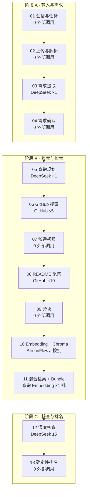

# ProjectPilot 运行逻辑、调用额度与排序规则说明

> 适用范围：当前 MVP-FROZEN 版本
> 编写日期：2026-11-25
> 依据：当前工作区代码与 2026-11-25 第三次真实全链路测试结果
> 说明：本文只描述现有实现，不提出新的架构或功能。

---

## 1. 总览

ProjectPilot 的一次完整运行分为三个阶段、13 个步骤：

- 阶段 A 输入与需求：会话 → 解析 → 提取 → 确认
- 阶段 B 搜索与检索：规划 → GitHub 搜索 → 初筛 → README → 分块 → Embedding/Chroma → 混合检索/Bundle
- 阶段 C 核查与排名：深度核查 → 确定性排名

一次完整运行的理论调用上限：

| 服务 | 上限 | 构成 |
|---|---:|---|
| DeepSeek | 7 次 | 需求提取 1 + 查询规划 1 + 深度核查 ≤5 |
| GitHub | 15 次 | 搜索 ≤5 + commit 5 + README 5 |
| Embedding | 文档 ≤512 块 / ≤262,144 tokens + 查询 1 批 | BAAI/bge-m3，1024 维 |
| 自动重试 | 0 次 | 所有付费调用均为单次尝试 |

---

## 2. 流程图



各步骤之间的“关卡”：

| 从 → 到 | 通过条件 | 不通过会怎样 |
|---|---|---|
| 02 → 03 | 解析 completed | 不产生模型费用 |
| 03 → 04 | 提取 completed | 不进入确认 |
| 04 → 05 | revision 已确认 | 不能搜索 |
| 05 → 06 | 计划已发布且查询数 ≤5 | 运行中断，不调 GitHub |
| 06 → 07 | 候选已持久化 | 无候选则无法采集 |
| 07 → 08 | 选出 ≤5 个仓库 | 不采集 |
| 08 → 09 | 快照稳定 | 不生成 Chunk |
| 09 → 10 | Chunk 数 >0 | 生成空/失败 Bundle |
| 10 → 11 | Chroma 写入校验通过 | 检索不发布 |
| 11 → 12 | 检索 ready 或 partial | 深审仍可能被阻止 |
| 12 → 13 | 报告 completed | 不生成排名 |

`search_status=partial` 且原因是 `PAGE_BUDGET` 属于单页预算下的正常停止，不是链路失败。

---

## 3. 各环节调用额度总表

| # | 环节 | 真实调用 | 硬上限 |
|---|---|---|---|
| 01 | 会话与任务 | 0 | 会话 24 小时；写请求 10 次/分钟；每任务 3 次搜索运行、3 次提取作业 |
| 02 | 上传解析 | 0 | 文件 10 MB；PDF 30 页；主文本 30,000 字符；补充 2,000 字符；解析 15 秒 |
| 03 | 需求提取 | DeepSeek 1 | 任务 3 次、会话 5 次、全局默认 5 次；输入 20k tokens；输出 6k tokens；90 秒；不重试 |
| 04 | 需求确认 | 0 | 最多 50 个需求修订 |
| 05 | 查询规划 | DeepSeek 1 | 3 组，每组 ≤3 条；每条 1–2 个概念、1–8 个词；整次运行 ≤5 条 |
| 06 | GitHub 搜索 | ≤5 | per_page 5；1 页；GitHub 总请求 ≤15 |
| 07 | 候选初筛 | 0 | 候选池最多 25；最终选 5 个采集 README |
| 08 | README 采集 | ≤10 | 每候选 commit + README；与搜索合计 ≤15 |
| 09 | 分块 | 0 | 512 tokens/块；重叠 64；每仓库 100；每次运行 1,000 |
| 10 | 文档 Embedding | 按批 | 512 块；32 批；262,144 tokens；批大小 16；1024 维 |
| 11 | 查询 Embedding | 1 批 | 当前实现单批；未命中缓存且去重后需求文本 >16 条可能触发预算错误 |
| 12 | 深度核查 | DeepSeek ≤5 | 5 个仓库；每仓库 16 块；输入 24,000 UTF-8 字节；输出 2,000 tokens；每条需求 2 条引用 |
| 13 | 排名 | 0 | 仅 completed/partial 仓库参与 |

补充说明：

- 当前手动验收环境将全局提取上限设为 10；代码默认值为 5。
- DeepSeek 的 7 次上限对应“一次提取 + 一次搜索 + 五个仓库深审”。
- 搜索预算在接口层固定，并满足：
  `github_requests ≥ search_requests + 2 × readme_candidates`
- 所有付费调用均不自动重试。

---

## 4. 分环节深层逻辑

### 4.1 会话、任务与幂等

- `owner = SHA-256(Bearer token)`。
- 任务、搜索运行、对象存储路径全部按 owner 隔离。
- 搜索提交使用 `Idempotency-Key + 请求哈希`：同一个键重放只返回原运行；键相同但载荷不同返回 409。
- 重复点击不会创建第二次付费运行。

### 4.2 上传与解析

- 文件/文本先计算内容哈希做幂等。
- 保存规范化文本、分段来源与字符偏移。
- 只有解析成功才允许发起需求提取；解析失败不产生模型费用。

### 4.3 需求提取

- 固定提示词 `requirements-v3`，输出严格 JSON。
- 每条需求必须带可追溯的 `evidence_ids`。
- 不确定信息保留为 `uncertain_information`，不允许模型猜测补齐。
- usage 只记录供应商真实返回值；未知 usage 保持 unknown。
- 调用前先做配额预留，避免“调用后才发现超限”。

### 4.4 需求确认

- 确认是显式人工动作。
- 存在未解决的不确定信息，或 ALL/ANY 逻辑不明确时禁止确认。
- 确认后的 revision 不可变，后续搜索、Bundle、深审全部绑定 `revision_hash`。
- 修改内容会生成新 revision，旧链路不复用。

### 4.5 查询规划

- 模型只能从来源目录复制指针（如 `/required_features/0`），不能自行编造来源。
- 系统校验来源分组、禁止项、否定语义、非法字符和布尔运算符。
- 提示词建议每条 3–4 个词，硬上限为 8 个词；模型风格偏差不会再导致整单失败。
- 规划失败会记录具体错误码（如 `PLANNER_QUERY_TOO_LONG`），不重试，不进入 GitHub/Embedding。

### 4.6 GitHub 搜索与候选初筛

- 搜索按组执行，按 `query_hash` 去重；结果只是候选召回，不代表满足需求。
- 单页预算耗尽记录 `PAGE_BUDGET`，运行状态为 partial，属于正常停止。
- 初筛只对仓库元数据（名称、描述、语言、topics）做字面提及匹配。
- 核心提及（项目主题、必需功能）权重高于次要提及，但该优先级只决定 README 采集顺序，不进入最终排名。
- 未提及 ≠ 不满足；没有提及的仓库仍保留为候选。

### 4.7 README 采集

- 默认分支 → commit SHA → 按该 SHA 读取 README 原始字节。
- 快照保存内容哈希与 blob SHA，保证引用可复现。
- 单个候选失败只标记该候选，不重试、不替换仓库。

### 4.8 分块

- 目标 512 tokens/块，重叠 64 tokens。
- 每仓库最多 100 块，每次运行最多 1,000 块。
- 优先按标题/代码块等结构切分，超长行再按字节切。
- 每块记录 `byte_start/byte_end`、`line_start/line_end` 和内容哈希。
- 块 ID 为 `snapshot:序号:哈希前缀`，是引用与深审的唯一合法边界。
- 非 UTF-8 内容标记 `non_utf8`、不生成块；块数超容量整次失败，不静默丢块。

### 4.9 Embedding 与 Chroma

- 先查本地内容缓存，未命中才真实调用。
- 每批成功立即持久化进度，进程中断后可续跑。
- 写入 Chroma 后逐块校验 chunk_id 与内容哈希。
- 失败会停止检索发布，但已保存的搜索与候选证据不回滚。

### 4.10 混合检索与 EvidenceBundle

每个仓库、每条需求：

```text
Dense Top-10 + BM25 Top-10 + 关键词 Top-10
        ↓ RRF(k=60)
    最终 Top-5
```

- RRF 只融合“名次”，不把距离或 BM25 分数相加。
- 相似度只负责召回，永远不进入推荐评分。
- Bundle 保存候选块坐标、召回方法、RRF 分数和真实 query_usage，只读不可变。
- 某仓库检索失败记为 partial；未召回不会写成“不满足”。

### 4.11 深度核查

- 每个仓库独立一次模型调用，最多 5 个仓库。
- 模型只输出 verdict、reason_code 和行号。
- Python 重新计算字节范围，并校验 quote、Chunk、仓库、Snapshot 归属。
- 引用末尾空行会被裁掉，`line_end` 指向最后一个有效行。
- `supports` / `contradicts` 必须有有效引用；引用被拒 → `insufficient`。
- ALL/ANY 由 Python 真值表聚合，不交给模型。
- 鉴权/余额错误会停止后续仓库；其他失败只标记该仓库，不重放。
- 输入 24,000 是 UTF-8 字节保守上界，不是 tokenizer 计数，不能展示为 Token。

---

## 5. 排序与“评分”的定义

### 5.1 没有数值评分

ProjectPilot 不使用权重、不累加分数、不使用相似度。  
排名是字典序（lexicographic）：

```text
sort_key = (
    硬约束层级,
    −首选需求的有效证据数,
    repository_id 字符串
)
```

模型分数、RRF 分数、stars、描述匹配度都不参与。

### 5.2 硬约束单元

- 单条 `required` / `prohibited` → 一个单元。
- 同一 `logic_group_id` 的多条 → 合并为一个 ALL/ANY 单元。
- `preferred` 不进入硬约束，只用于同层级第二排序键。

### 5.3 单元结果判定

```text
声明 fail，或（推导 fail 且引用有效）      → fail
supports/contradicts 但无有效引用           → unknown
声明值与推导值不一致                         → unknown
其余（pass/unknown 且一致）                  → 原值
```

ALL/ANY 规则：

- ALL：有 fail 即 fail；全部 pass 才 pass；否则 unknown。
- ANY：有 pass 即 pass；全部 fail 才 fail；否则 unknown。

### 5.4 单元结果决定层级

| 条件 | 层级 | 顺序 |
|---|---|---:|
| 任一单元 fail | hard_conflict | 2 |
| 无硬约束 / 仓库 partial / 覆盖不足 / 任一 unknown | needs_review | 1 |
| 全部 pass 且覆盖 full | meets_requirements | 0 |

### 5.5 同层级排序

第二键：**首选需求的有效证据数**。

计数条件：

1. verdict = `supports`；
2. 引用 chunk_id 属于该仓库本次模型输入。

统计的是“首选需求被原文支持了多少条”，不是“提及了多少词”。

第三键：`str(repository_id)` 升序。注意是字符串比较，不是数字大小。  
即使前两键相同，顺序也唯一、可复现。

### 5.6 推荐状态与理由码

| 条件 | 推荐状态 | reason_code |
|---|---|---|
| hard_conflict | not_recommended | HARD_CONSTRAINT_CONFLICT |
| 没有硬约束 | needs_review | NO_HARD_CONSTRAINTS |
| README 覆盖不完整 | needs_review | README_COVERAGE_INCOMPLETE |
| 有单元 unknown | needs_review | HARD_CONSTRAINT_EVIDENCE_INSUFFICIENT |
| 全部 pass | recommended | HARD_CONSTRAINTS_MET |

推荐理由文字由 Python 模板生成，引用来自对应硬约束单元或首选需求；模型不直接写推荐语。

### 5.7 排除规则

只有 `completed / partial` 的仓库进入排名。  
`failed / unknown / skipped` 进入 `excluded_repositories`，带原因码，不占名次。

### 5.8 第三次真实测试的排序验证

五个仓库全部为 `needs_review`，首选证据数全部为 0，因此顺序完全由 `repository_id` 字符串升序决定：

```text
1240724129  marcelolszewski911/transcription-pipeline
124553714   agar2995/Transcription-of-audio-video-files-...
658228761   samuelbradshaw/text-to-timestamps
732061528   bakaburg1/minutemaker
842846538   mikeesto/gemini-transcribe
```

这不是按 stars 或相似度排序，而是严格按 `(tier, −preferred, id)` 计算。

### 5.9 设计理由

- 可解释：每个名次都能追溯到硬约束结果和证据条数。
- 确定性：同一份报告重复计算，结果完全一致。
- 抗模型漂移：模型只提供判断和行号，排序由 Python 固定规则完成。
- 不把相似度当质量：向量距离和 RRF 只负责召回。
- 不可刷分：没有可被 stars、README 长度或关键词堆砌影响的权重。

---

## 6. 状态与失败语义

| 状态 | 含义 |
|---|---|
| `partial` + `PAGE_BUDGET` | 单页搜索预算耗尽，正常停止 |
| `needs_review` | 证据不足或覆盖不完整，不是明确失败 |
| `hard_conflict` | 明确违反 required/prohibited |
| `insufficient` | 没有足够有效引用，不能下结论 |
| `excluded_repositories` | 仓库运行失败/未知/跳过，不参与排名 |
| `cost_status=not_calculated` | 没有计价模块，不编造金额 |

---

## 7. 当前实现边界

1. README 只是公开文档，不代表源码审计、代码运行验证或部署可用性。
2. 因此大量结果是 `needs_review`，这不是系统失败。
3. 查询 Embedding 当前按单批设计：未命中缓存且去重后需求文本超过 16 条时可能触发 `EMBEDDING_BUDGET`；T07 为 6 条，未触发。
4. 所有费用均未计算；只记录供应商返回的真实 usage。
5. 排名没有人工调权；“想让它偏向某类项目”只能改硬约束/首选需求判定，不能调分数。

---

## 8. 代码位置

| 内容 | 位置 |
|---|---|
| 搜索预算上限 | `backend/app/services/search_routes.py:20` |
| 查询硬上限（1–8 词） | `backend/app/services/query_planner.py:176` |
| 提取配额 | `backend/app/services/requirements.py:26`、`:279`、`:305` |
| 分块常量 | `backend/app/services/chunking.py:8` |
| 深审常量（5 仓库 / 16 块 / 24,000 字节 / 2,000 tokens） | `backend/app/services/deep_review_models.py:15`、`deep_review_logic.py:15` |
| 检索参数（Top-10 / 10 / 5，RRF k=60） | `backend/app/services/retrieval.py:7` |
| 硬约束单元与层级 | `backend/app/services/deep_review_logic.py:289`、`:346` |
| 首选证据统计 | `backend/app/services/deep_review_logic.py:356` |
| 推荐映射 | `backend/app/services/deep_review_logic.py:380` |
| 最终排序键 | `backend/app/services/deep_review_logic.py:454` |

---

## 9. 结论

ProjectPilot 的运行链路是“需求提取 → 搜索召回 → README 证据 → 混合检索 → 逐仓库核查 → 确定性排名”。

排序不是打分，而是三级字典序：

```text
硬约束层级 → 首选需求有效证据数 → repository_id 字符串升序
```

这套规则牺牲了一部分“细腻度”，换来了可解释、可复现、不可刷分和抗模型漂移。对比赛 MVP 而言，这是比加权评分更稳妥的选择。
